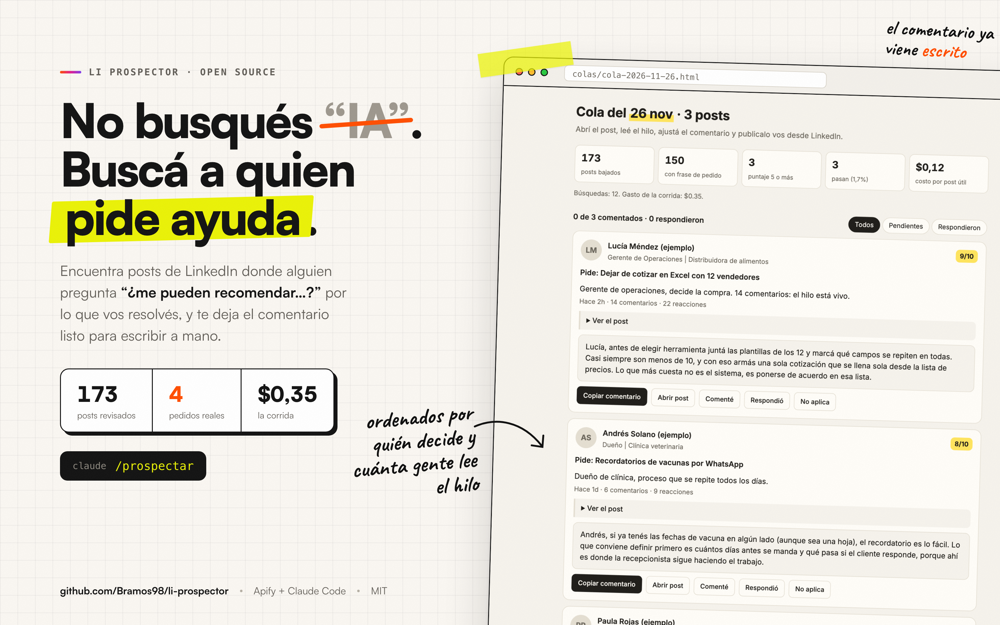

# LI Prospector

Encuentra posts de LinkedIn donde alguien **pide** ayuda con lo que vos resolvés ("¿me pueden recomendar...?", "¿alguien conoce...?") y te arma una cola diaria con el comentario ya escrito. Vos lo leés, lo ajustás y lo publicás a mano.

La idea: si buscás por tema (por ejemplo "IA"), LinkedIn te muestra a los que hablan del tema, o sea a tu competencia. El que tiene el problema no escribe "IA", escribe "alguien me recomienda a quien me ayude con...". Este proyecto busca esa forma de hablar.



## Qué necesitás

- [Claude Code](https://claude.com/claude-code): es el que califica los posts y escribe los comentarios.
- [Node.js](https://nodejs.org) 22.9 o más nuevo.
- Una cuenta gratis de [Apify](https://apify.com). El plan gratis trae $5 al mes, y una corrida cuesta entre $0,30 y $0,60.

## Cómo se instala

```bash
git clone https://github.com/Bramos98/li-prospector.git
cd li-prospector
cp .env.example .env
```

Abrí `.env` y pegá tu token de Apify (lo sacás de [console.apify.com/settings/integrations](https://console.apify.com/settings/integrations)). No hace falta `npm install`: no usa dependencias.

## Cómo se usa

1. Abrí Claude Code en la carpeta y escribí `/prospectar`.
2. La primera vez te hace unas preguntas para llenar `docs/mis-criterios.md`: qué vendés, a quién y qué pedidos te sirven. Hay un ejemplo lleno en `docs/ejemplo-benramosai.md`.
3. Después busca, califica y te abre la cola del día en el navegador.
4. Abrí cada post, leé el hilo, ajustá el comentario y publicalo vos.

Para probar otras frases sin tocar el config: `/prospectar "alguien sabe","necesito un proveedor"`.

## Qué hace por dentro

| Paso | Quién | Dónde queda |
|---|---|---|
| Busca posts de la última semana con cada frase y descarta los que no tienen pedido o que ya vio | `npm run recolectar` | `data/corridas/<fecha>/candidatos.txt` |
| Califica cada post y escribe el comentario | Claude, con `docs/mis-criterios.md` | `data/corridas/<fecha>/calificados.json` |
| Arma la cola por puntaje y por cantidad de comentarios del hilo | `npm run cola` | `colas/cola-<fecha>.html` |

La búsqueda usa el actor [`harvestapi/linkedin-post-search`](https://apify.com/harvestapi/linkedin-post-search) de Apify, que no pide tu cookie ni tu cuenta de LinkedIn. Cuesta $0,002 por post (precio de noviembre de 2026; revisalo en Apify).

## Lo que aprendimos probándolo

- El buscador de LinkedIn no respeta bien `AND` / `OR`. Por eso cada frase va en su propia búsqueda.
- Si a la frase le sumás un tema ("me recomiendan" + "IA"), vuelven los vendedores. Con la frase sola salen pedidos reales de todo tipo, y Claude se queda con los tuyos.
- Esperá mucho ruido: en la primera corrida pasaron 4 de 173 posts. La mayoría era gente buscando empleo o inversores. Por eso cuesta centavos y no lo revisás vos a mano.
- "qué herramienta usan" no trajo ni un pedido. "busco socio" y "alguien sabe" traen sobre todo empleo. Podá las frases que no te rindan.

## Qué podés cambiar

- **Frases, antigüedad de los posts y tamaño de la cola:** `config.json`.
- **Qué pedidos sirven y cómo se escribe el comentario:** `docs/mis-criterios.md`.

## Reglas

- **El comentario lo publicás vos.** Automatizar comentarios va contra las reglas de LinkedIn y arriesga tu cuenta.
- Un comentario que responde de verdad le sirve a todos los que leen el hilo. Uno que vende ("te escribo por DM") no.
- Los datos que baja (`data/`, `colas/`) son de otras personas y quedan solo en tu computadora. El `.gitignore` ya los deja fuera.
- Lo que marcás en la cola (comenté, respondió) se guarda en ese navegador, no en un archivo.

## Licencia

MIT. Hecho por [BenRamos.ai](https://benramos.ai).
